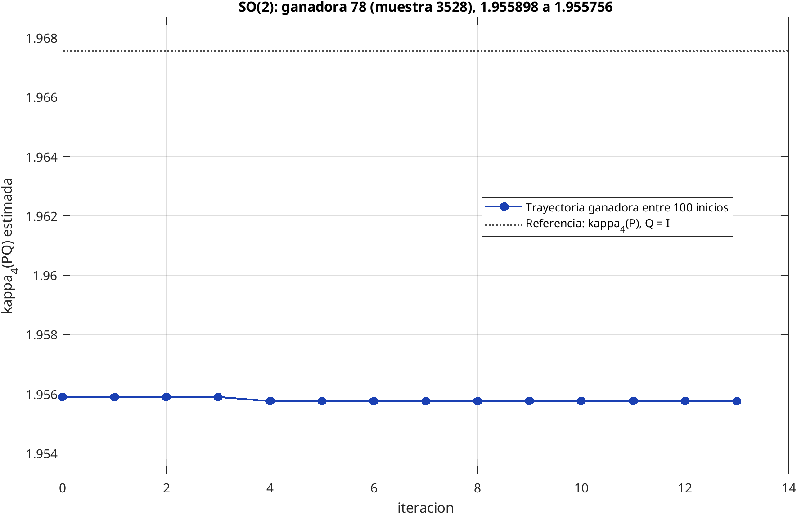
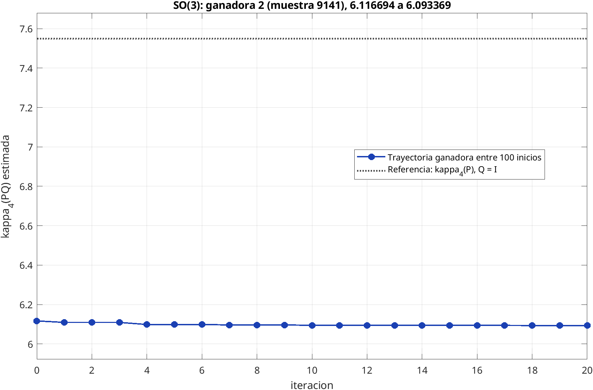

## Purpose of this document

This document presents a general formulation for minimizing an estimate of the condition number induced by the 4-norm within a family of matrices of the form $PQ$, where $Q$ is a rotation. It describes the multistart estimation of induced norms, the use of fixed direction banks, probing via Givens rotations, and a progressive trajectory-discarding process.

The method is a local search over an estimated objective function. Therefore, it produces the best candidate found under the given conditions.

## Optimization problem

### Matrix family and covariance constraint

Let $\Sigma_e\in\mathbb{R}^{K\times K}$ be a symmetric positive definite matrix, and let $P$ be one of its factorizations such that

$$
PP'=\Sigma_e.
$$

For example, $P$ can be a Cholesky triangular factor. Consider the family

$$
B(Q)=PQ,
$$

with

$$
Q\in SO(K)
=\left\{Q\in\mathcal{O}(K):\det(Q)=1\right\}
$$

The rotation does not alter the reconstructed covariance:

$$
B(Q)B(Q)'
=(PQ)(PQ)'
=PQQ'P'
=PP'
=\Sigma_e.
$$

Thus, the optimization selects an orientation within a family that shares the same covariance.

### Induced 4-norm

For $x\in\mathbb{R}^K$, the vector 4-norm is

$$
\|x\|_4
=\left(\sum_{j=1}^{K}|x_j|^4\right)^{1/4}.
$$

The corresponding induced matrix norm is^[Conditioning the induced 4-norm on the set of unit 4-norm vectors $\|x\|_4=1$ makes it possible to bound the search space.]

$$
\|A\|_4
=\max_{x\ne0}\frac{\|Ax\|_4}{\|x\|_4}
=\max_{\|x\|_4=1}\|Ax\|_4.
$$

Consequently, the condition number induced by the 4-norm is defined as

$$
\kappa_4(A)
=\|A\|_4\,\|A^{-1}\|_4.
$$

The problem is defined as:

$$
\boxed{
Q^{*}=\text{argmin}_{Q\in SO(K)} F(Q),
\qquad
F(Q)=\kappa_4(PQ)
=\|PQ\|_4\,\|(PQ)^{-1}\|_4
}.
$$

## Estimated objective function

### Multistart estimation of the induced norm

Computing $\|A\|_4$ requires maximizing over the unit 4-norm sphere. The generalized power iteration method is applied from several initial directions and keeps the largest feasible amplitude observed. If $X$ is a finite bank of directions, the result is an estimate of the induced 4-norm.

$$
\widehat{\nu}_4(A;X)
$$

Given two banks of directions

$$
X_f\in\mathbb{R}^{K\times S_f},
\qquad
X_i\in\mathbb{R}^{K\times S_i},
$$

the numerical objective function is

$$
\widehat{F}(Q)
=
\widehat{\nu}_4(PQ;X_f)
\widehat{\nu}_4(Q'P^{-1};X_i).
$$

The essential point of both vector banks is that they remain fixed while the induced 4-norm is computed for each matrix $PQ$. This guarantees that a matrix $Q$ is neither favored nor penalized by the set of directions used.

::: {.callout-important title="Deterministic comparisons"}
All compared candidates must be evaluated with the same direction banks. If the directions are changed on every evaluation, the observed differences mix the effect of $Q$ with sampling variation. Keeping the banks fixed makes the objective function deterministic for a given matrix $P$ and given direction banks.
:::

### Internal screening of directions

In the phase of computing the induced 4-norm, because an iterative algorithm is used to estimate the minimum of the objective function, the cost of refining all directions to convergence can be high. For this reason a screening strategy is applied as follows:

1. apply a small number of preliminary iterations to all directions;
2. keep the directions with the highest $\kappa_4$;
3. restart only those selected directions from their initial values and refine them with the maximum number of iterations possible.

## Construction of the fundamental space and preservation of the elites

### Sampling of rotations

Rotations can be sampled using the Haar method. The usual procedure consists of starting from a Gaussian matrix, computing its $QR$ factorization, correcting the signs associated with the diagonal of the triangular factor, and adjusting the determinant to belong to $SO(K)$.

The rotations are evaluated with a bank of directions used only for computing the induced 4-norm, and a subset of the best candidates (elites) is retained. The sample size and the number of retained candidates are design decisions.

### Canonicalization

In problems where signed permutations preserve the vector 4-norm, a rotation $Q$ can share the exact value of the objective function with $QS$, where $S$ is a signed permutation matrix with determinant one. To choose a representation close to the identity, $S$ can be selected by maximizing

$$
\operatorname{tr}(QS).
$$

This is equivalent to minimizing the Frobenius distance to the identity, since

$$
\|QS-I\|_F^2
=2K-2\operatorname{tr}(QS).
$$

## Pattern Search over $SO(K)$

### General idea

Pattern Search is a direct search method that compares objective function values over a structured set of directions without computing gradients.

In the fundamental search space it is not advisable to add arbitrary perturbations to $Q$, because the orthogonality constraint would be lost. Instead, multiplying by small Givens rotations preserves membership in $SO(K)$.

### Givens rotations

For each pair of indices $1\leq i<j\leq K$, let $G_{ij}(\theta)$ be the Givens rotation in the plane $(i,j)$ defined by

$$
\begin{bmatrix}
\cos\theta & -\sin\theta\\
\sin\theta & \cos\theta
\end{bmatrix}.
$$

Since

$$
G_{ij}(\theta)'G_{ij}(\theta)=I,
\qquad
\det G_{ij}(\theta)=1,
$$

it follows that

$$
Q_{\mathrm{trial}}=QG_{ij}(\theta)\in SO(K)
$$

whenever $Q\in SO(K)$. For a mesh size (perturbation) $\Delta>0$, both signs are tried:

$$
Q_{\mathrm{trial}}=QG_{ij}(\sigma\Delta),
\qquad
\sigma\in\{-1,+1\}.
$$

Consequently, the search pattern contains $2\binom{K}{2}=K(K-1)$ probes.

### Acceptance rule

Let $Q_m^{(t)}$ be the candidate of trajectory $m$ at iteration $t$, with value

$$
f_m^{(t)}=\widehat{F}\!\left(Q_m^{(t)}\right)
$$

and mesh size $\Delta_m^{(t)}$. A probe is accepted if it strictly improves the value of the current rotation:

$$
\widehat{F}\!\left(
Q_m^{(t)}G_{ij}(\sigma\Delta_m^{(t)})
\right)
< f_m^{(t)},
$$

The search can be opportunistic: the first direction that satisfies the rule is accepted and probing for that trajectory stops at the current iteration, or the objective function can be evaluated at all possible directions.

### Mesh update and termination

The mesh, represented by $\Delta$, is the size of the turn tested at each probe. Each trajectory has its own mesh: it can take larger steps when it finds improvements and smaller steps when it does not.

If a trajectory accepts a turn because it sufficiently reduces the estimated value of $\kappa_4(PQ)$, the next angular step becomes larger, without exceeding the allowed maximum:

$$
\Delta_m^{(t+1)}
=
\min\left(
\Delta_{\max},
\gamma_{\mathrm{exp}}\Delta_m^{(t)}
\right),
\qquad
\gamma_{\mathrm{exp}}>1.
$$

If none of the tested turns satisfies the acceptance rule, the current rotation is kept and the step becomes smaller:

$$
\Delta_m^{(t+1)}
=
\gamma_{\mathrm{con}}\Delta_m^{(t)},
\qquad
0<\gamma_{\mathrm{con}}<1.
$$

In these expressions, $\gamma_{\mathrm{exp}}$ determines how much the step grows and $\gamma_{\mathrm{con}}$ how much it shrinks. A small step allows examining turns closer to the current rotation, but it does not prove that the best possible value has been found.

The search for a trajectory stops when one of these events occurs:

- the step becomes smaller than the tolerance set for the mesh: very small turns are already being tried;
- the maximum number of rounds set for the search is reached.

These reasons describe why the computation ended; none of them, by itself, certifies a global minimum.

### Outline of the procedure

The procedure can be read as several searches starting from different rotations. Each one keeps its own rotation, its estimated value, and its step size. In practical terms:

1. Several initial rotations are chosen and the value of each one is estimated with the same fixed direction banks.
2. Each trajectory is assigned the initial angular step $\Delta_0$.
3. At each iteration, small turns of the trajectories are tried.
4. For each trajectory, either all possible Givens rotations are tried, or the search can act opportunistically and accept the first turn that achieves the descent.
5. The step is increased if there was an improvement, or reduced if there was not.
6. At the end, the trajectories' values are compared and the rotation with the lowest estimated value is returned.

## Progressive discarding of trajectories

### Motivation

Since this is a search algorithm, it is proposed to use several trajectories as starting points^[Each initial Q matrix is a trajectory]. A trajectory is the search that begins at an initial rotation and continues over several rounds. In each round it keeps its current rotation, its estimated value, and its step size.

The number of trajectories depends on how many initial rotations are chosen. For example, with 100 initial rotations there are 100 trajectories. In dimension 9, for instance, there are 36 Givens planes and up to 72 possible probes **per trajectory and per round**; the opportunistic search can stop probing a trajectory before trying them all if it finds an improvement. It is important to note that this decision involves a balance between computational efficiency and the exhaustiveness of the search.

Once the above is taken into account, the progressive discarding strategy consists of gradually eliminating the least promising trajectories at each round, until a reduced number of candidates remain that continue the search.

### Selection rule and state continuity

At each stage, only the trajectories that remain active are considered. They are ordered according to the pair:

$$
\left(f_m^{(t)},m\right),
$$

first by their evaluation $f_m^{(t)}$ (lower is better) and then by the index of their initial rotation $m$, which resolves ties reproducibly. If the next stage admits $R$ trajectories, the first $R$ active trajectories from that stage continue.

A surviving trajectory must keep its complete state:

- current matrix $Q_m^{(t)}$;
- current value $f_m^{(t)}$;
- mesh size $\Delta_m^{(t)}$;

Survivors continue from their accumulated state, without returning to the initial rotation or resetting the step or the counters. At the end of the algorithm, a single winning trajectory is returned.

## Implementation of pattern search in the Out of Sample Selection Tool

- The procedure starts from several initial rotations, which are canonicalized before beginning. The matrix $P$ and the direction banks used to estimate both norms remain fixed during the search, so that candidates are compared under the same conditions.
- Each trajectory tries Givens rotations in both directions for each pair of coordinates.
- The search is **opportunistic**: in each round, the first turn whose estimated value is strictly lower than that trajectory's current condition number is accepted. Its other turns are no longer tried in that round, to reduce evaluations and computation time.
- By default, the initial angular step is $\Delta_0=0.05$ radians and the maximum is $\Delta_{\max}=0.25$ radians. After an improvement, the step is doubled, without exceeding the maximum; if there is no improvement, it is halved. A trajectory stops if the step falls below $0.001$ or reaches 50 rounds. The examples may change these values.
- **Progressive discarding**: In the dimension-9 example, the search begins with 100 trajectories, keeps 25 after round 10 and 5 after round 30, with a limit of 50 rounds. At each cut point, the active trajectories with the lowest condition number are chosen, and ties are broken by the lowest origin index.
- At the end, the trajectory with the lowest estimated value is chosen and its rotation is returned. The result is a local candidate for an estimated function, not a guaranteed global minimum.

## Graphical examples of condition number reduction

In each example, 10,000 Haar rotations are sampled and $\widehat{\kappa}_4(PQ)$ is estimated for each one. The 100 rotations with the lowest estimates are used as 100 distinct initial points for Pattern Search; therefore, 100 trajectories are refined. The figure shows the winning trajectory: the one whose final estimated value is the lowest among the 100. The dotted horizontal line is the estimate of $\kappa_4(P)$, that is, the reference value for $Q=I$. In this way we have a comparison with the traditional Cholesky decomposition.

### Case of $2\times2$ matrices

10,000 Haar rotations were sampled and canonicalized in $SO(2)$, and $\widehat{\kappa}_4(PQ)$ was evaluated to select the 100 with the lowest value. Pattern Search was started from those 100 rotations, one trajectory per initial point.

The curve shows the history of the trajectory that ended with the lowest estimate among the 100: it dropped from $1.955898$ to $1.955756$ in 13 rounds.

{#fig-cond4-path-2x2 width=85%}

### Case of $3\times3$ matrices

10,000 Haar rotations were also sampled and canonicalized in $SO(3)$; they were evaluated with the fixed banks, and the 100 with the lowest estimate were selected to start 100 Pattern Search trajectories.

The curve presents the trajectory with the lowest final estimated value among the 100: it went from $6.116694$ to $6.093369$ in 20 rounds.

{#fig-cond4-path-3x3 width=85%}

### Case of $5\times5$ matrices

10,000 Haar rotations were sampled in $SO(5)$. Each rotation was brought to its canonical representative and evaluated with the fixed banks; the 100 lowest estimates determined the initial points of 100 Pattern Search trajectories.

Compared to the previous cases, this trajectory shows a more pronounced decrease in the estimated value of $\kappa_4(PQ)$ when using Pattern Search.

{#fig-cond4-path-5x5 width=85%}

### Case of $9\times9$ matrices

For $SO(9)$ the same procedure was followed: 10,000 Haar rotations were sampled and canonicalized, their condition numbers were estimated with the fixed banks, and Pattern Search was started from the 100 lowest estimates.

As in the case of $SO(5)$, the decrease remains more pronounced compared to the lower-dimensional cases. Of the 4 cases addressed, this is the one that presents the largest decrease in the estimated value of $\kappa_4(PQ)$.

{#fig-cond4-path-9x9 width=85%}

## References

1. Virginia Torczon (1997), “On the Convergence of Pattern Search Algorithms”, *SIAM Journal on Optimization*, 7(1), 1–25. [https://doi.org/10.1137/S1052623493250780](https://doi.org/10.1137/S1052623493250780).
2. Charles Audet and J. E. Dennis Jr. (2002), “Analysis of Generalized Pattern Searches”, *SIAM Journal on Optimization*, 13(3), 889–903. [https://doi.org/10.1137/S1052623400378742](https://doi.org/10.1137/S1052623400378742).
3. Francesco Mezzadri (2007), “How to Generate Random Matrices from the Classical Compact Groups”, *Notices of the AMS*, 54, 592–604. [arXiv:math-ph/0609050](https://arxiv.org/abs/math-ph/0609050).
4. Nicholas J. Higham (1992), “Estimating the Matrix $p$-Norm”, *Numerische Mathematik*, 62, 539–555. [https://doi.org/10.1007/BF01396242](https://doi.org/10.1007/BF01396242).
